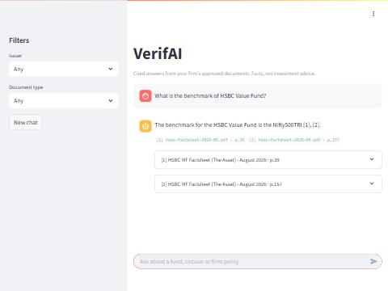

# Financial Advisory Compliance RAG Assistant

A Retrieval-Augmented Generation (RAG) application for helping financial
advisors verify answers against approved market research, fund
factsheets, and regulatory disclosures.

> **Important:** This application is designed to retrieve and explain
> information from approved documents. It is not a substitute for
> professional compliance review or independent financial/legal advice.

## Submission links (Sprint 2)

| Piece | Where |
|---|---|
| Pull requests | [All merged PRs](https://github.com/itzhimanshugt/team03-65-Sprint-2/pulls?q=is%3Apr+is%3Amerged): one PR per concept (C1–C40), each with "What this PR covers" and walkthrough notes |
| PRD | [PRD.md](PRD.md): problem, users, knowledge source, KPIs, evaluation set |
| Mock UX | [Figma file](https://www.figma.com/design/S3lVpz5bkKkSrrjuv9URYr/team03-sprint2-verifai-?node-id=0-1) · annotations and empty states in [docs/MOCK_UX_ANNOTATIONS.md](docs/MOCK_UX_ANNOTATIONS.md) · built screens in [docs/screenshots](docs/screenshots) |
| Architecture | [docs/ARCHITECTURE.md](docs/ARCHITECTURE.md) |
| Live app | https://verifai-vysj.onrender.com |
| Board | [Sprint 2 project board](https://github.com/users/itzhimanshugt/projects/2) |

## RAG pipeline at a glance

```text
Documents ──► Chunk ──► Embed ──► Vector DB ──► Retrieve ──► LLM answer
 20 approved   400-token   gemini-        ChromaDB     top-20 → re-rank   Gemini (free tier),
 PDF/HTML/     chunks, 60  embedding-001  (cosine,     → top-5 → same-     answers only from the
 MD/TXT files  overlap,    768-D,         HNSW)        page neighbours     numbered context, with
               metadata    L2-normalised               + evidence gate     [n] citations
```

| Stage | Code | Output |
|---|---|---|
| Load + clean | `ingestion/loaders.py`, `ingestion/cleaner.py` | plain text per page/section, boilerplate removed |
| Chunk + metadata | `ingestion/chunker.py`, `ingestion/metadata.py` | `data/processed/chunks.jsonl` (3,528 chunks) |
| Embed | `embeddings/embedder.py`, `embeddings/batch.py` | `data/processed/embeddings.npy` (resumable cache) |
| Index | `retrieval/vector_store.py`, `retrieval/indexer.py` | ChromaDB at `data/chroma` |
| Retrieve | `retrieval/search.py`, `retrieval/reranker.py`, `retrieval/neighbours.py` | top-5 cited chunks |
| Answer | `rag/pipeline.py`, `rag/context.py`, `rag/citations.py`, `rag/guardrails.py`, `rag/conversation.py` | grounded answer + citations, or a refusal |
| Serve | `app/api/main.py` (FastAPI), `app/ui/streamlit_app.py` (Streamlit) | API + chat UI |

## Data source

The knowledge base is **20 approved documents** listed in [data/catalog.csv](data/catalog.csv), with each document's type, issuer, title, publish date and version. They are fetched with `python -m scripts.download_corpus`.

| Type | Documents |
|---|---|
| Fund factsheets | HSBC MF (Jul + Aug 2026), PPFAS MF (Aug + Sep 2026) |
| Scheme documents | Parag Parikh Liquid Fund SID and KIM |
| SEBI circulars | Master Circular for MFs (Mar 2026), Master Circular for Investment Advisers (Jun 2025 + Feb 2026), 3 circulars from Jul 2026 (intraday borrowing, SWP/STP in demat, SIF distribution) |
| Investor education | SEBI (mutual funds, riskometer), Tata MF (riskometer), Motilal Oswal (exit load), Zerodha (ratios) |
| Firm internal (simulated) | Advisor FAQ, client communication guidelines, product shelf notes |

**Versions:** older versions (Jul HSBC, Aug PPFAS, Jun 2025 IA circular) are kept with `is_latest=false` and excluded from retrieval by default.

## Embeddings

- **Model:** `gemini-embedding-001` through Gemini's OpenAI-compatible endpoint, 768 dimensions, L2-normalised (so cosine, dot product and Euclidean distance rank the same).
- **Batching:** at most 100 chunks or 8,000 tokens per request, with rate-limit retries.
- **Resumable cache:** a run stopped by the free tier's daily quota (~1,000 chunks) loses nothing.
- **Question cache:** question embeddings are cached on disk, so evaluation reruns cost no quota.
- **Sanity checks:** `python -m scripts.embedding_sanity`, reported in `outputs/c20/sanity.md`.

## Live demo

**Demo:** https://verifai-vysj.onrender.com (free Render plan: first load after idle takes ~30–60 s). Deploy steps: [docs/DEPLOY.md](docs/DEPLOY.md).



## Quick start

```bash
pip install -r requirements-dev.txt
cp .env.example .env                      # add your free Gemini key as LLM_API_KEY
python -m scripts.download_corpus         # approved sample documents → data/raw
python -m scripts.ingest_corpus           # load → clean → chunk → metadata
python -m scripts.embed_corpus            # resumable; the free tier allows ~1,000 chunks/day
python -m scripts.build_index             # ChromaDB at data/chroma
uvicorn app.api.main:app --reload         # API + Swagger at http://localhost:8000/docs
streamlit run app/ui/streamlit_app.py     # chat UI at http://localhost:8501
```

Architecture: [docs/ARCHITECTURE.md](docs/ARCHITECTURE.md) · PRD: [PRD.md](PRD.md) · Mock UX: [docs/MOCK_UX_ANNOTATIONS.md](docs/MOCK_UX_ANNOTATIONS.md)

## API

| Endpoint | Purpose |
|---|---|
| `POST /chat` | Cited answer, refusal flag, citations with chunk text (filters: issuer, doc_type) |
| `POST /chat/stream` | Same answer as server-sent events: `token`… then `done` with citations |
| `POST /documents` | Upload PDF/HTML/TXT/MD → index (duplicates rejected, new versions supersede old ones) |
| `GET /documents` | Indexed documents with version and `is_latest` |
| `GET /stats` | Requests, cache hits, refusals, p95 latency |
| `GET /health` | Status and number of chunks indexed |

## Problem Statement

A financial advisory firm maintains market research, fund factsheets,
and regulatory disclosures, but advisors risk giving non-compliant
guidance because they cannot verify answers against the latest approved
documents.

The application creates a searchable knowledge base from approved
documents and uses retrieval before answer generation.

## Core Workflow

``` text
Documents
  ↓
Load → Extract → Clean → Chunk + Metadata
  ↓
Embeddings → Vector Database
  ↓
User Question → Query Embedding → Similarity Search
  ↓
Filter / Re-rank → Context Assembly
  ↓
LLM → Grounded Answer + Citations
```

## Core Features

-   Document intake and text extraction
-   Text cleaning and chunking
-   Source/position metadata
-   Embedding generation
-   Vector database storage
-   Semantic top-K retrieval
-   Metadata filtering
-   Optional hybrid search and re-ranking
-   Grounded generation
-   Source citations
-   Hallucination/refusal guardrails
-   Conversational follow-ups
-   Backend RAG API
-   Document upload and indexing
-   Chat UI
-   Streaming responses
-   Logging and usage monitoring
-   Retrieval and answer-quality evaluation

## Target Users

**Financial Advisors:** Verify information from approved documents
before communicating guidance.

**Knowledge/Compliance Teams:** Maintain the approved document knowledge
base.

## Example User Flow

1.  Upload an approved document.
2.  Extract and clean its text.
3.  Split it into chunks.
4.  Attach source metadata.
5.  Generate embeddings.
6.  Index embeddings in the vector database.
7.  Ask a question.
8.  Retrieve relevant chunks.
9.  Filter/re-rank candidates if required.
10. Assemble context.
11. Generate a grounded answer.
12. Display citations.
13. Refuse or ask for clarification when evidence is insufficient.

## Project Structure

```text
app/          config, LLM client, prompts, tokens, history, observability; api/ (FastAPI), ui/ (Streamlit)
ingestion/    loaders, cleaner, chunker, metadata, pipeline, upload
embeddings/   embedder (+ question cache), batch, similarity, sanity
retrieval/    vector_store, indexer, search, hybrid, reranker, neighbours
rag/          pipeline, context, citations, guardrails, conversation
evaluation/   eval_set.jsonl (40 labelled questions), retrieval_eval, answer_eval
prompts/      system, answer, condense templates
scripts/      one runnable script per step and demo (outputs go to outputs/cNN/)
outputs/      evidence for each concept
docs/         ARCHITECTURE, MOCK_UX_ANNOTATIONS, DEPLOY, screenshots
tests/        ~125 offline tests
```

## Environment Setup

``` bash
python -m venv .venv
```

macOS/Linux:

``` bash
source .venv/bin/activate
```

Windows:

``` bash
.venv\Scripts\activate
```

Install dependencies:

``` bash
pip install -r requirements-dev.txt   # app + test/lint tools
```

## Environment Variables

All settings, with defaults, are in [.env.example](.env.example). Only `LLM_API_KEY` is secret. The defaults use Google Gemini's free tier through its OpenAI-compatible endpoint.

## Retrieval

`rag.pipeline.answer()` retrieves in these steps:

```text
Question (follow-ups rewritten into a standalone question from the last 4 turns)
  ↓  embed (cached)
Vector search in ChromaDB: top-20, metadata filter (latest version by default; optional issuer / doc_type)
  ↓
Lexical re-rank → top-5 (bonus for question words, strongest when they appear in the chunk's first tokens)
  ↓
Evidence gate: refuse if the best cosine score is below 0.72
  ↓
Same-page neighbours: the next chunk of each top-3 hit, so facts split across a boundary stay whole
  ↓
Numbered context [1]…[k] with source, page and date, at most 3,000 tokens → LLM
```

Hybrid search (BM25 + RRF, `retrieval/hybrid.py`) was built and evaluated, but it scored lower on this corpus (Recall@5 0.57 vs 0.83), so vector search plus re-ranking is the default. See `outputs/c27`.

## Vector Store

ChromaDB, persistent at `CHROMA_PATH` (default `data/chroma`, git-ignored), one collection:

| Setting | Value |
|---|---|
| Collection | `verifai_chunks` |
| Distance | cosine (`hnsw:space = cosine`; Chroma returns distance = 1 − cosine similarity) |
| Vector size | `EMBEDDING_DIMENSIONS` (768), checked when the collection opens |
| Embedding function | none: vectors always come from `embed_texts` (L2-normalised) |
| `id` | `chunk_id` (`{doc_id}-{chunk_index:04d}`) |
| `document` | chunk text |
| `metadata` | `doc_id`, `chunk_index`, `source_name`, `title`, `doc_type`, `issuer`, `family`, `published_date`, `version`, `is_latest`, `page`, `token_count`, `checksum` |

Metadata keeps everything needed to **cite** (source, page, version) and to **filter** (type, issuer, date, latest only), so retrieval never has to reopen the source files.

## Grounded Generation

`rag/pipeline.py` runs **retrieve (vector top-20) → re-rank → top-5 → evidence gate → numbered context (≤ 3k tokens) → LLM → citation check**.

- **Weak evidence** (top cosine < 0.72) → refusal before any LLM call (Mock UX S2c).
- **Advice-seeking** questions → a non-advice notice plus facts (S2d).
- **Follow-ups** are rewritten into standalone questions from the last 4 turns.
- **`[n]` markers** that point to sources the model was not shown are dropped.

**Design principle:**

> No reliable retrieved evidence → no invented answer.

## Evaluation

The labelled set is [evaluation/eval_set.jsonl](evaluation/eval_set.jsonl): 40 questions (25 factual, 5 multi-document, 6 unanswerable, 4 advice).

```bash
python -m scripts.retrieval_eval   # K1/K2 → outputs/c27
python -m scripts.tune_retrieval   # k and threshold grid → outputs/c25
python -m scripts.rerank_eval      # with / without re-ranking → outputs/c26
python -m scripts.answer_eval      # 40 questions end to end, K5/K6/K8 + K3/K4 review sheet → outputs/c34
```

## Security

``` text
.env         → local secrets
.env.example → safe template
.gitignore   → excludes .env
```

Never commit API keys or expose them in logs.

## Testing

```bash
pytest        # ~120 offline tests: no API calls (LLM, embeddings and vector store are faked)
ruff check .
```

CI runs ruff, pytest and gitleaks on every PR.

## GitHub Workflow

See [CONTRIBUTING.md](CONTRIBUTING.md) for branch naming, PR rules and the protections on `main`. Track work on the [Sprint 2 board](https://github.com/users/itzhimanshugt/projects/2).

``` text
Issue → Feature Branch → Implementation → Testing → Pull Request → Review → Merge
```

Example:

``` bash
git checkout -b feature/document-ingestion
git add .
git commit -m "feat: implement document ingestion"
git push -u origin feature/document-ingestion
```

## Sprint 2 Status

**Status:** all 40 concepts are implemented, one PR each. Results from the final evaluation run (25 Oct 2026, all 3,528 chunks from 20 documents indexed):

| KPI | Target | Result |
|---|---|---|
| K1 Recall@5 | ≥ 0.85 | 0.83 (vector; unchanged by re-ranking) |
| K2 MRR@5 | ≥ 0.70 | **0.79** with re-ranking ✅ |
| K3 Citation accuracy | ≥ 90% | **100%** (47 / 47 citations supported) ✅ |
| K4 Hallucination rate | ≤ 5% | **0%** (0 / 29 answers with an unsupported claim) ✅ |
| K5 Correct refusals | ≥ 90% | **90%** ✅ |
| K6 False refusals | ≤ 10% | **0%** ✅ |
| K8 Latency | p95 ≤ 8 s; first token ≤ 2 s | p95 11.1 s (non-streamed eval); first token 2.2–4.6 s ❌ (free-tier model) |
| — Answer spot check | — | 29 / 30 answerable questions correct and complete |

## Limitations

- **Free tier:** about 1,000 embeddings a day, so the full corpus took 4 runs over 3 days (see `outputs/c19`). Free-tier latency also misses the K8 target.
- **Hybrid search:** BM25 + RRF scored lower than vector search on this corpus, because factsheets repeat fund-type words on every page. The lexical re-ranker is used instead.
- **Images:** riskometer dials and other images in PDFs are not read. Answers rely on the text near them.
- Quality depends on the approved documents. The system cannot guarantee legal or regulatory compliance.

## Team

**Squad:** 65\
**Team:** 03\
**Project:** Financial Advisory Compliance RAG Assistant

Team contributions should be tracked through GitHub issues, branches,
commits, and pull requests.

## License

This project is developed as part of the Kalvium Simulated Work Sprint
2.
