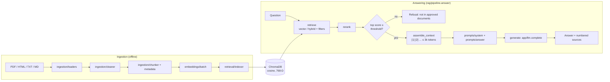

# VerifAI — Architecture

Two flows share one vector store: **ingestion** (offline, per document) and **answering** (online, per question).

## Stages in `rag/pipeline.py`

| Stage | Type | Default now | Replaced by |
|---|---|---|---|
| retrieve | `(question) -> list[Hit]` | `retrieval.search.search` (vector top-5, latest only) | `retrieval.hybrid.hybrid_search` (C24) after tuning (C25) |
| rerank | `(question, hits) -> list[Hit]` | identity | re-ranker (C26) |
| evidence gate | `max(score) < threshold` → refuse | `REFUSAL_THRESHOLD=0.45` | guardrails (C32) |
| assemble_context | `(hits, budget) -> (text, used)` | numbered blocks with citation, 3k-token budget | context injection (C29) |
| generate | `(messages) -> str` | `app.llm.complete` with free-tier model fallbacks | grounded generation, streaming (C30, C38) |

## Module responsibilities

| Package | Owns |
|---|---|
| `ingestion/` | Load, clean, chunk, and attach metadata (issuer, doc type, version, `is_latest`) |
| `embeddings/` | Embedding API calls, batching, quota-safe on-disk cache |
| `retrieval/` | Chroma store, indexing, vector search, BM25 + RRF hybrid, metadata filters |
| `rag/` | The answering flow above |
| `app/` | Settings, LLM client, prompts, tokens; API (C35) and UI (C37) |
| `evaluation/` | Retrieval and answer-quality evaluation (C27, C34) |

## Design rules
- **Each stage is a function argument.** A later concept swaps one stage, and tests use fakes, so no API calls happen in CI.
- **Refuse before the LLM.** Weak evidence never reaches the model, which saves quota and blocks hallucination at the source.
- **Sources are numbered in the prompt**, so the `[n]` citations in the answer map straight back to `Answer.sources`.
