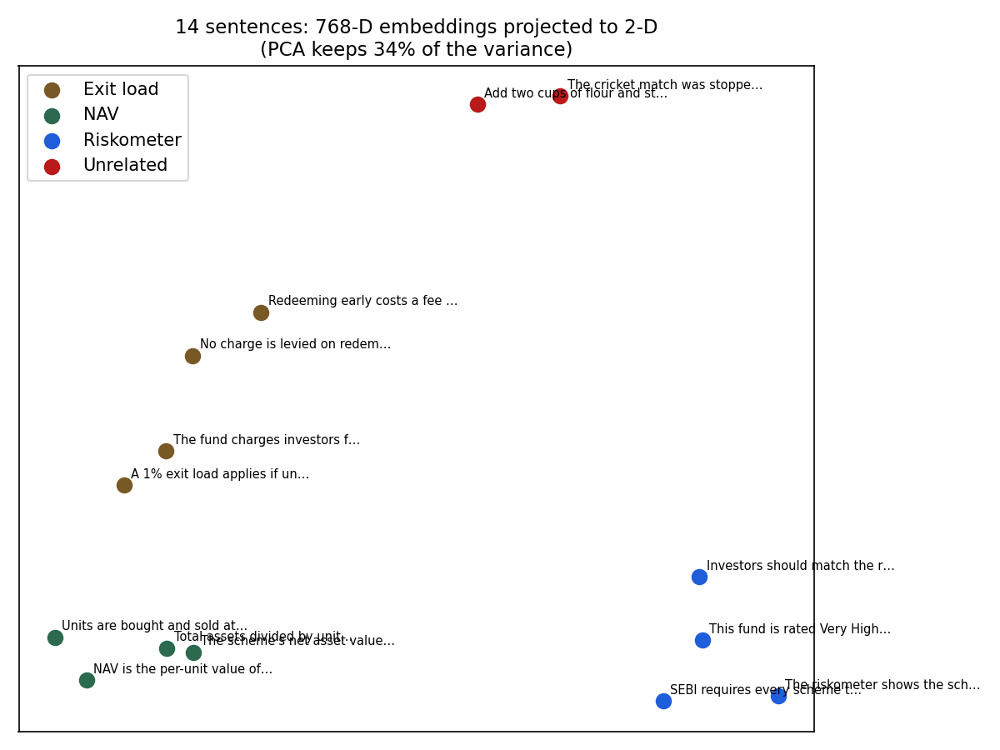

# C16 — Embeddings: similar meaning, nearby vectors

Average cosine similarity between sentences (diagonal = same topic):

| | Exit load | NAV | Riskometer | Unrelated |
|---|---|---|---|---|
| **Exit load** | 0.75 | 0.61 | 0.57 | 0.48 |
| **NAV** | 0.61 | 0.72 | 0.55 | 0.45 |
| **Riskometer** | 0.57 | 0.55 | 0.73 | 0.47 |
| **Unrelated** | 0.48 | 0.45 | 0.47 | 0.49 |
